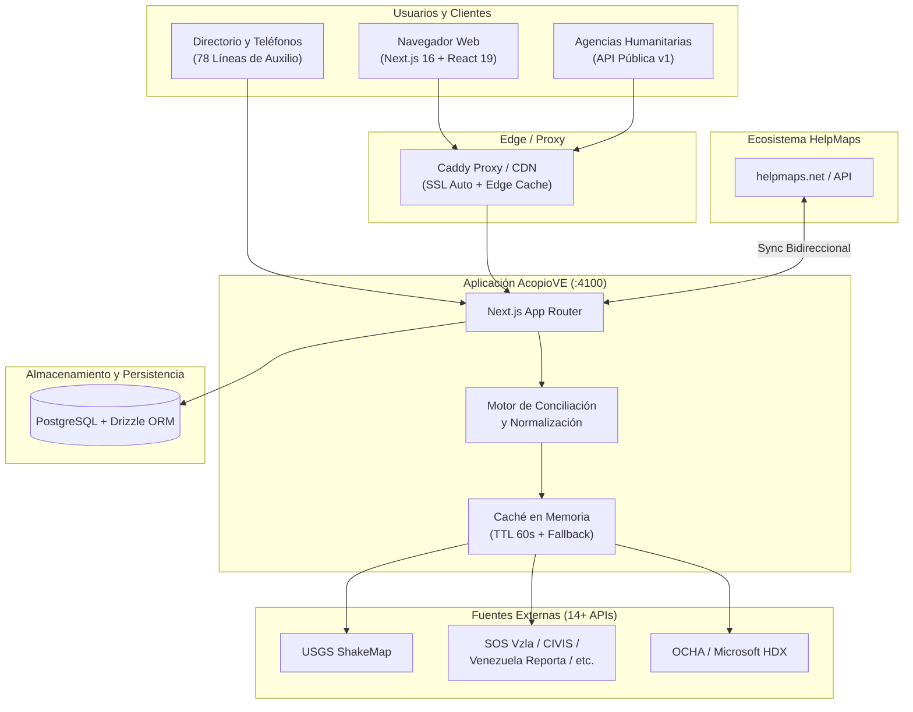

# AcopioVE — Resumen Ejecutivo y Resultados del Proyecto
> **Nota (oct 2026):** el proyecto fue cerrado; los servicios en vivo mencionados abajo ya no están activos.
> **Plataforma Humanitaria y de Datos Abiertos de Emergencia**  
> Terremoto Venezuela 2026 · [acopiove.org](https://acopiove.org) · Ecosistema [helpmaps.net](https://helpmaps.net) · API Pública: [api.acopiove.org/v1](http://localhost:4100/v1)

---

## 1. Visión General: ¿Qué es y qué hace AcopioVE?

**AcopioVE** es una plataforma tecnológica de respuesta humanitaria desarrollada para atender de forma inmediata y coordinada el impacto del terremoto de 2026 en Venezuela y articular los esfuerzos de auxilio tanto en territorio nacional como con la diáspora.

Su propósito central es **eliminar la asimetría de información, evitar la duplicación de esfuerzos y conectar necesidades urgentes con recursos disponibles en tiempo real** para damnificados, rescatistas, brigadas médicas, voluntarios, ONG y donantes.

### Módulos Principales y Evolución Operativa
1. **Landing Institucional y de Posicionamiento (`/`)**: Portada oficial orientada a SEO, métricas en vivo desde PostgreSQL, presentación del balance del proyecto y acceso al catálogo de datos abiertos.
2. **API Pública Abierta (`/v1`) — Servicio Activo Canónico**: Catálogo bajo licencia **CC-BY-4.0** en formatos JSON, GeoJSON y CSV (`/v1/centros`, `/v1/telefonos`, `/v1/puntos`, `/v1/submissions`) para que agencias humanitarias, desarrolladores y la red global de HelpMaps consuman los datos verificados.
3. **Resumen Ejecutivo y Resultados (`/resumen`)**: Presentación interactiva y balance institucional de la respuesta humanitaria.
4. **Directorios SEO y Accesibilidad (`/centros`, `/refugios`, `/telefonos`)**: Directorios renderizados en servidor (SSR) optimizados para conexiones lentas y motores de búsqueda.
5. **Transición de Mapas y Búsquedas a HelpMaps**: El mapa interactivo 2D, el visor 3D de daños y el motor consolidado de búsqueda de personas se integraron dentro de la infraestructura federada de `helpmaps.net`, redirigiendo las rutas históricas de AcopioVE hacia la landing principal para maximizar la estabilidad y centralizar el consumo vía API.
6. **Capas Científicas y Datos Satelitales**: Integración de ShakeMap del USGS, sismicidad histórica, réplicas, alertas tempranas globales (GDACS) y evaluaciones satelitales (Microsoft AI for Good / OCHA HDX).
7. **Boletín de Prensa Sintetizado con IA**: Filtro y resumen automático de más de 12 medios nacionales e internacionales sobre la evolución de la emergencia para combatir rumores y desinformación.

---

## 2. Métricas y Volumen de Datos Manejados

El proyecto opera bajo un modelo híbrido: **Fuente canónica propia** para infraestructura de acopio/refugios/teléfonos y **Agregador en tiempo real** para datos dinámicos de personas y daños.

```
┌─────────────────────────────────────────────────────────────────────────┐
│                          MÉTRICAS CLAVE                                 │
├──────────────────────────────┬──────────────────────────────────────────┤
│ 🏢 Centros de Acopio y Refugios│ 716 centros activos en 24 países        │
│    • Centros de Acopio       │ 664 centros                              │
│    • Refugios y Albergues    │ 52 refugios                              │
├──────────────────────────────┼──────────────────────────────────────────┤
│ 👥 Fichas de Personas/Entidades│ ~3,000 registros conciliados en vivo     │
├──────────────────────────────┼──────────────────────────────────────────┤
│ 📞 Directorio de Emergencia  │ 78 líneas y brigadas verificadas         │
├──────────────────────────────┼──────────────────────────────────────────┤
│ 🌐 Red de Intérpretes        │ 1,878 voluntarios registrados (snapshot) │
├──────────────────────────────┼──────────────────────────────────────────┤
│ 🏗️ Edificios Dañados (3D)    │ 2,000+ estructuras con % de daño        │
├──────────────────────────────┼──────────────────────────────────────────┤
│ 📡 Fuentes Externas Integradas│ 14+ APIs y plataformas comunitarias      │
└──────────────────────────────┴──────────────────────────────────────────┘
```

### Fuentes de Datos Externas Integradas
- **Personas y Asistencia**: *SOS Venezuela*, *Localizados Venezuela*, *CIVIS Venezuela*, *Venezuela Reporta*, *Terremoto Venezuela*, *Reporte VE*, *REDH AVAPRE*, *De Mano en Mano*, *Hospitales Venezuela*.
- **Datos Científicos y Satelitales**: *USGS Earthquake Hazards*, *Microsoft AI for Good / OCHA HDX*, *TerraVE Sentinel-1*, *GDACS*, *Open-Meteo*.
- **Directorio de Apoyo**: *Interp-Aid* (directorio público de traductores e intérpretes sincronizado).

---

## 3. Alcance Internacional y Combate a la Desinformación

### 3.1. Coordinación con la Diáspora (24 Países)
- Canalización de ayuda humanitaria desde el exterior (EE. UU., España, Colombia, Chile, México, Argentina, etc.).
- Filtro por categorías específicas de insumos (*agua, alimentos, higiene, medicamentos críticos, material quirúrgico*) para orientar envíos internacionales.

### 3.2. Lucha contra la Desinformación con IA
- Monitoreo automatizado de feeds RSS de prensa nacional e internacional (*BBC Mundo, DW, UN OCHA, ReliefWeb, Efecto Cocuyo, El Diario, El Nacional*).
- Síntesis neutral periódica con IA servida desde una caché eficiente (369+ aciertos) que ofreció un panorama claro sin generar gastos de infraestructura ni saturar servidores.

---

## 4. Alianza, Evolución e Integración con HelpMaps (`helpmaps.net`)

Uno de los hitos organizativos y técnicos más significativos del proyecto fue su sinergia y consolidación con la plataforma **HelpMaps**:

### 4.1. Origen de la Cooperación
AcopioVE y HelpMap compartieron desde el inicio de la emergencia el mismo espíritu de auxilio humanitario. Mientras HelpMap centró sus primeros desarrollos en flujos de datos en Supabase, Vercel y recolección comunitaria, AcopioVE se especializó en un motor geoespacial de alta concurrencia, conciliación multi-fuente en memoria y visualizaciones 2D/3D sobre infraestructura dedicada.

### 4.2. Modelo de Integración: Autoridad por Dominio
Para evitar la duplicidad de datos y garantizar máxima confiabilidad, ambos equipos establecieron un protocolo de integración federado y bidireccional:

| Dominio / Entidad | Autoridad Canónica | Flujo de Integración |
|---|---|---|
| **Centros de Acopio, Refugios y Teléfonos** | **AcopioVE** | HelpMap consume el endpoint `GET /v1/centros` (vía sincronización automatizada con lógica *freshest-wins* y vinculación por `external_id`). |
| **Pacientes en Hospitales y Datos Clínicos** | **HelpMap** | AcopioVE ingiere el endpoint `GET /api/v1/patients` de HelpMap en su motor de personas (`/api/personas`), aplicando enmascaramiento estricto de PII. |
| **Sugerencias y Aportes Ciudadanos** | **Compartido** | HelpMap reenvía sugerencias de puntos mediante `POST /v1/submissions`, integrándose directamente en la cola de moderación de AcopioVE sin crear duplicados. |

### 4.3. Consolidación: AcopioVE es ahora parte de HelpMaps (`helpmaps.net`)
Como resultado de esta estrecha colaboración, **`acopiove.org` pasó a formar parte integral de la red global de `helpmaps.net`**.

Esta unión permite:
1. **Escalabilidad Regional**: La tecnología y motores de agregación de AcopioVE sirven como base técnica para despliegues rápidos en futuras emergencias humanitarias bajo la marca HelpMaps.
2. **Ecosistema Unificado**: Una sola red de voluntarios, equipos de verificación y canales de difusión trabajando bajo un mismo paraguas técnico.
3. **Respaldo Institucional**: Fortalecimiento de alianzas con organismos internacionales y ONG globales que ya reconocen a HelpMaps como nodo de referencia en catástrofes.

---

## 5. Arquitectura y Principios de Ingeniería



### Principios de Diseño del Sistema
1. **Fuente de Verdad vs. Agregador sin Retención**:
   - AcopioVE persiste en PostgreSQL únicamente la información que modera y valida directamente: centros propios, sugerencias y directorio telefónico.
   - **Los datos de personas NO se persisten en base de datos**: se consultan en paralelo desde las APIs de las organizaciones de origen en cada petición, se normalizan con algoritmos fonéticos/texto y se concilian en memoria. Esto garantiza frescura absoluta y previene almacenamiento no autorizado de datos sensibles.
2. **Semáforo de Verificación Comunitaria**:
   - Los clusters del mapa no reflejan cantidad numérica, sino **estado de confirmación**:
     - 🟢 **Verde**: Confirmado recientemente por la comunidad en campo (`/confirmar`).
     - 🟡 **Ámbar**: Datos vigentes sin confirmar en los últimos 7 días.
     - 🔴 **Rojo**: Más de 7 días sin actualización de operatividad.
3. **Filtros por Insumo y Necesidad Inmediata**:
   - Algoritmo de clasificación por categoría requerida (alimentos, agua potable, medicinas, material quirúrgico, herramientas) para evitar sobre-donación y equilibrar el abastecimiento.

---

## 6. Operación en Producción, Tráfico y Resultados Reales

### 6.1. Rendimiento, Carga y Tráfico Web
- **Uptime Ininterrumpido**: Más de **109 días de operación continua** en producción sobre Ubuntu 22.04 LTS con 0 caídas no programadas.
- **Edge Caching y Latencia**:
  - **TTFB (Time to First Byte)** en página principal: **~0.16 s** gracias a políticas de caché en Edge (Cloudflare + Caddy).
  - Endpoint de datos de mapa (`/v1/puntos`): Respuestas en **<0.17 s** con cabeceras `s-maxage=300, stale-while-revalidate=600` logrando un alto ratio de **Edge Cache HIT**, lo que protegió al servidor central de saturación ante picos de tráfico.
  - **SEO y Accesibilidad**: Puntuación de **100/100 en SEO** (Lighthouse) con sitemap dinámico (`sitemap.xml`), `robots.txt` y soporte para indexación por LLMs (`llms.txt`).

### 6.2. Comportamiento del Motor de Búsqueda y Conciliación
- **Agregación Multi-API en Paralelo**: El backend consulta simultáneamente más de una docena de endpoints externos con un límite de espera (*timeout*) estricto.
- **Tolerancia a Fallos (*Graceful Degradation*)**: Cuando una fuente comunitaria externa sufre caídas de conectividad o errores de DNS, el agregador la aísla y entrega los resultados consolidados del resto de fuentes sin interrumpir la experiencia del usuario.
- **Caché en Memoria de 60 Segundos**: Evita el *rate-limiting* hacia servidores externos y reduce la latencia en búsquedas concurrentes.

### 6.3. Políticas de Respaldo y Continuidad Operativa (DRP)
- **Frecuencia Cuádruple Diaria**: Ejecución automatizada de respaldos cada 6 horas (`00:30`, `06:30`, `12:30`, `18:30`).
- **Respaldo Local + Replicación Cloud Off-site**: Cada volcado `.sql.gz` se valida localmente y se transmite de forma cifrada a un bucket de almacenamiento seguro en la nube (Cloudflare R2), garantizando recuperación ante desastres sin pérdida de datos.

### 6.4. Moderación Comunitaria y Calidad de la Información
- **Reducción de Puntos sin Contacto**: Se redujo el porcentaje de centros sin teléfono verificado mediante campañas activas y transcripción comunitaria.
- **Panel de Moderación en Vivo (`/admin`)**: Aprobación y descarte de sugerencias ciudadanas sin intermediación de despliegues de código, manteniendo la cola de espera de solicitudes públicas en 0.

---

## 7. Privacidad, Seguridad y Protección de Datos (PII)

Dada la sensibilidad de los datos en situaciones de rescate y vulnerabilidad, AcopioVE implementó salvaguardas estrictas:

- **Enmascaramiento de Identidad (Cédulas)**: Censura y truncado automático de números de documento de identidad en cualquier salida pública.
- **Protección de Menores y Pacientes**: Supresión de coordenadas GPS exactas, eliminación de teléfonos personales privados y ocultamiento de ubicación precisa para menores de edad reportados.
- **Seguridad de Red y Autenticación**:
  - Protección perimetral con **UFW** y **Fail2Ban** (con más de 800 IPs maliciosas bloqueadas en tiempo real).
  - Autenticación con cookies `httpOnly`, firmas criptográficas JWT (`jose`) y control de acceso basado en roles (**RBAC** con roles `superadmin` y `cargador`).
  - Cabeceras de seguridad estrictas: `HSTS` (`max-age=31536000`), `X-Content-Type-Options: nosniff`, `X-Frame-Options: SAMEORIGIN` y CSP restrictiva.

---

## 8. Guía de Presentación: Puntos Clave para la Exposición

```
┌─────────────────────────────────────────────────────────────────────────┐
│                       ESTRUCTURA DEL PITCH                              │
├─────────────────────────────────────────────────────────────────────────┤
│ 1. EL PROBLEMA:                                                         │
│    Durante la emergencia surgieron decenas de listas en PDFs, tweets y  │
│    mensajes de WhatsApp dispersos y desactualizados, generando caos.    │
├─────────────────────────────────────────────────────────────────────────┤
│ 2. LA SOLUCIÓN ACOPIOVE:                                                │
│    Una plataforma abierta, rápida y neutral que unificó en un solo mapa │
│    y buscador 716 centros en 24 países y ~3,000 registros de personas. │
├─────────────────────────────────────────────────────────────────────────┤
│ 3. ALCANCE INTERNACIONAL Y CERTEZA INFORMATIVA:                         │
│    Articulación con la diáspora (24 países) y combate a la              │
│    desinformación con síntesis periódica de noticias verificadas.       │
├─────────────────────────────────────────────────────────────────────────┤
│ 4. LA ALIANZA Y EVOLUCIÓN CON HELPMAPS:                                 │
│    Unificación bajo helpmaps.net: integración bidireccional de datos    │
│    (acopios y refugios de AcopioVE + pacientes de HelpMap) y escala     │
│    regional para futuras emergencias.                                   │
├─────────────────────────────────────────────────────────────────────────┤
│ 5. LA INNOVACIÓN TÉCNICA Y PRIVACIDAD:                                  │
│    • Conciliación en memoria multi-fuente sin almacenar datos sensibles.│
│    • Semáforo de frescura comunitaria para evitar llevar ayuda a        │
│      centros colapsados o cerrados.                                     │
│    • Asistentes de WhatsApp/Telegram para zonas con baja conectividad.  │
├─────────────────────────────────────────────────────────────────────────┤
│ 6. EL IMPACTO Y RESULTADOS:                                             │
│    109+ días de estabilidad total (0 caídas), datos abiertos CC-BY-4.0  │
│    y adopción comunitaria.                                              │
└─────────────────────────────────────────────────────────────────────────┘
```

---

## 9. Conclusión

**AcopioVE**, hoy integrado formalmente en la red global **`helpmaps.net`**, validó que es posible construir una infraestructura humanitaria moderna, ágil y de código abierto en tiempo récord, logrando coordinar a la sociedad civil, las instituciones y la comunidad internacional bajo un estándar común de transparencia, privacidad y eficiencia tecnológica.
